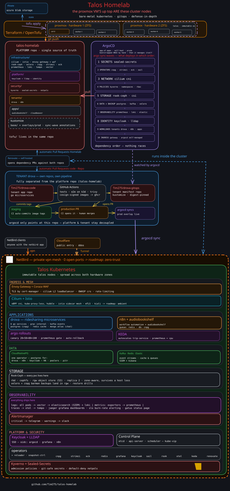

<h1 align="center">Homelab 🏡</h1>

Repository for home infrastructure and Kubernetes cluster using GitOps practices.

Held together using Proxmox VE, OpenTofu, Talos Linux, Kubernetes, Argo CD and copious amounts of YAML — with some help from Renovate.

🔌 Homelab currently offline.

🌍 Live: [homepage.timourhomelab.org](https://homepage.timourhomelab.org) (offline)

[](https://www.talos.dev/)
[](https://kubernetes.io/)
[](https://opentofu.org/)
[](https://argo-cd.readthedocs.io/)


## Architecture Diagram

[](https://raw.githubusercontent.com/Tim275/talos-homelab/main/docs/homelabarchitecture.svg)

<sub>click the diagram for full resolution</sub>

## ⚙️ Core Components

- [Proxmox VE](https://www.proxmox.com/): Server management and KVM hypervisor.
- [Talos Linux](https://www.talos.dev/): Secure, immutable Linux for Kubernetes.
- [OpenTofu](https://opentofu.org/): Open source infrastructure as code tool.
- [Cilium](https://cilium.io/): eBPF-based networking, observability and security.
- [Rook-Ceph](https://rook.io/): Distributed block, file and object storage.
- [Argo CD](https://argo-cd.readthedocs.io/): Declarative GitOps continuous delivery for Kubernetes.
- [Renovate](https://docs.renovatebot.com/): Automated dependency updates.
- [Cert-manager](https://cert-manager.io/): Cloud native certificate management.
- [Envoy Gateway](https://gateway.envoyproxy.io/): Gateway API implementation for incoming traffic.
- [Cloudflare Tunnel](https://developers.cloudflare.com/cloudflare-one/connections/connect-networks/): Public services without open ports.
- [NetBird](https://netbird.io/): Zero-trust VPN for private access.
- [Istio](https://istio.io/): Service mesh in ambient mode.
- [Keycloak](https://www.keycloak.org/): Single sign-on with OpenID Connect.
- [LLDAP](https://github.com/lldap/lldap): Lightweight user directory.
- [OpenBao](https://openbao.org/): Secrets management.
- [External Secrets](https://external-secrets.io/): Syncs secrets from OpenBao into Kubernetes.
- [Kyverno](https://kyverno.io/): Policy as code.
- [Tetragon](https://tetragon.io/): eBPF-based runtime security.
- [CloudNativePG](https://cloudnative-pg.io/): PostgreSQL database operator.
- [Strimzi](https://strimzi.io/): Apache Kafka on Kubernetes.
- [Prometheus](https://prometheus.io/) and [Grafana](https://grafana.com/): Metrics, alerting and dashboards.
- [Loki](https://grafana.com/oss/loki/) and [Alloy](https://grafana.com/oss/alloy/): Log collection and storage.
- [Velero](https://velero.io/): Backup and restore.

## 📦 Apps

- [n8n](https://n8n.io/): Workflow automation.
- [Drova](https://github.com/Tim275/drova-gitops): Ride-sharing microservices showcase, a tenant with its own repository.
- [Forgejo](https://forgejo.org/): Self-hosted Git.
- [Uptime Kuma](https://uptime.kuma.pet/): Status page.
- [pgAdmin](https://www.pgadmin.org/): PostgreSQL administration.
- [Homepage](https://gethomepage.dev/): Start page for the homelab.
- [Excalidraw](https://excalidraw.com/): Whiteboard.

## 🗃️ Folder Structure

```
.
├── docs/                    architecture diagram, runbooks, kubectl OIDC config
├── tofu/
│   ├── stacks/              one root module per state: cluster, cloudflare, netbird, uptime-kuma, state
│   └── modules/             talos, openbao, proxmox-csi-plugin, volumes, gitlab
└── kubernetes/
    ├── argocd/              control plane: bootstrap (Argo CD itself, root), projects, clusters, applicationsets, crds
    ├── infrastructure/      what the cluster runs on: network, storage, security, monitoring, cluster
    ├── platform/            what teams and apps consume: identity, observability (dashboards, logs, traces), data, delivery, automation
    ├── apps/                self-hosted services: forgejo, uptime-kuma, pgadmin, homepage, n8n
    ├── tenants/             one namespace, one AppProject, own repository: drova
    └── parked/              kept, not deployed, see its README
```

## 📐 Rules

A component has up to three parts:

- `base/` is the same in every environment: the objects, the component's own technology and shared Helm values. No hostnames, addresses, mails, node names, sizes or chart versions.
- `components/<technology>/` plugs the component into another platform technology: `envoy-gateway`, `rook-ceph`, `kube-prometheus-stack` (its ServiceMonitor), `cilium` (its network policies), `cert-manager`, `cnpg`, `istio`.
- `overlays/prod/` is what this cluster adds: the chart version and `values.yaml`, secrets, `settings.yaml` (hostnames, URLs, mails, IDs), `sizing.yaml` (replicas, resources, storage, retention), `placement.yaml` (node pins) and the `components:` in use.

Argo CD:

- `argocd/bootstrap` is applied once by hand: Argo CD, its project and the root Application. The root creates `argocd` (Argo CD manages itself from then on), `projects`, `clusters`, `crds` and `applicationsets` in that order. CRDs come first so every component can ship its own CRs.
- One ApplicationSet per layer: `infrastructure`, `platform`, `apps`, `tenants`. Each is a matrix of the cluster entries (selected by label) and rows `{ name, path, namespace }`, one Application per row with unlimited retry, so a cold start settles on its own. The Application name is the folder name, sub-components are named `parent-child`.
- One AppProject per layer and one per tenant. A project allows only the namespaces and kinds its applications render; a tenant may deploy any namespaced kind into its own namespace.
- `infrastructure` and `platform` sync automatically with prune and self-heal. `apps` and `tenants` sync manually: the merge is the review, the rollout is a deliberate click.
- An operator and the custom resources it serves are separate Applications (`velero` and `velero-schedules`), because Argo CD cannot validate a custom resource before its CRD exists.
- 16 operators deploy from `rendered/manifests.yaml`, the rendered output of their `overlays/prod`. CI fails on drift, so a PR shows the real diff.
- Metrics and alerting are infrastructure (`infrastructure/monitoring`): they page for the cluster itself. Dashboards, logs and traces are platform. Alert rules live in `infrastructure/monitoring/alerting/base/rules/`. `dashboard_url` is a path, the Alertmanager template adds the host. Runbooks live in `docs/runbooks/`.
- `parked/` keeps components that are not deployed. CI, lint and Renovate skip it.

New component: a folder with `base/` and `overlays/prod/` plus a row in the ApplicationSet of its layer. New tenant: `tenants/<name>/` with namespace, quota, limits and RBAC, an AppProject in `argocd/projects/` and rows in `tenants`; data services are sub-components with their own rows.

## 🚀 Bootstrap

```sh
cd tofu/stacks/cluster && tofu init && tofu apply -parallelism=1 && cd -
export KUBECONFIG=tofu/stacks/cluster/output/kube-config.yaml
mise run bootstrap
kubectl get applications -n argocd -w
```

`mise run bootstrap` installs Argo CD, the `argocd` project and the root Application. Argo CD creates everything else.

Rebuild order, backups and secrets: `docs/runbooks/neuaufbau.md`.
