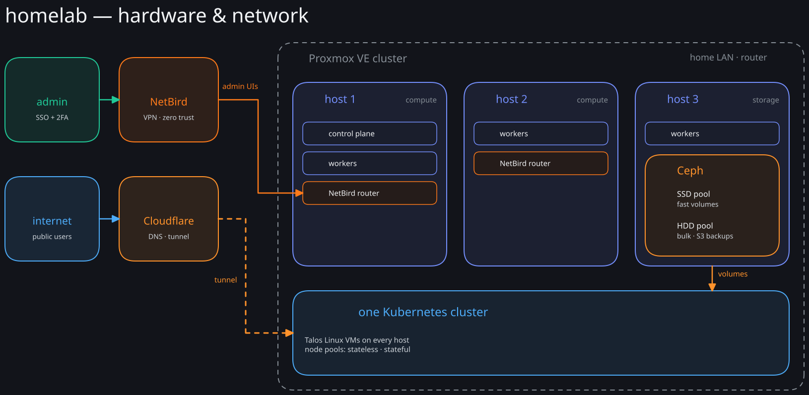
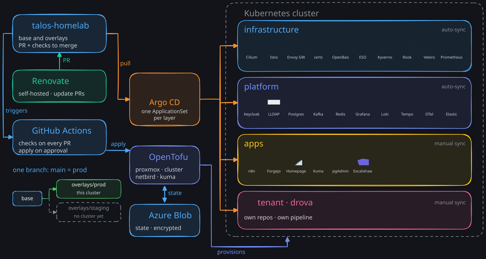
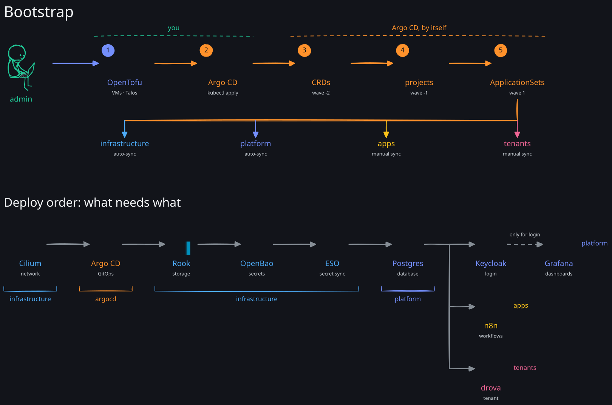
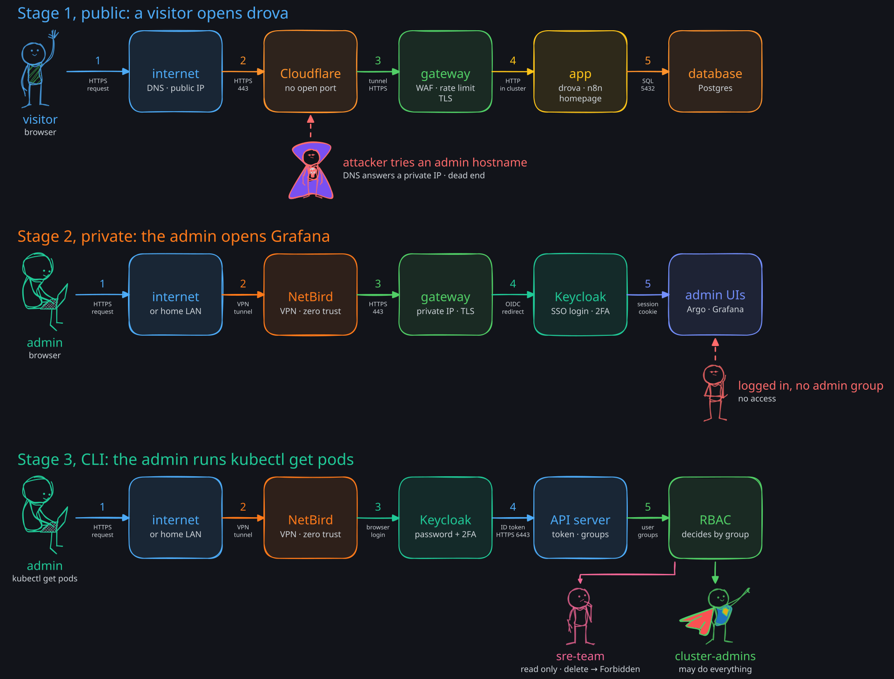
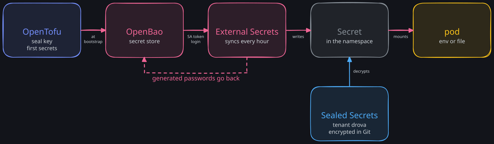
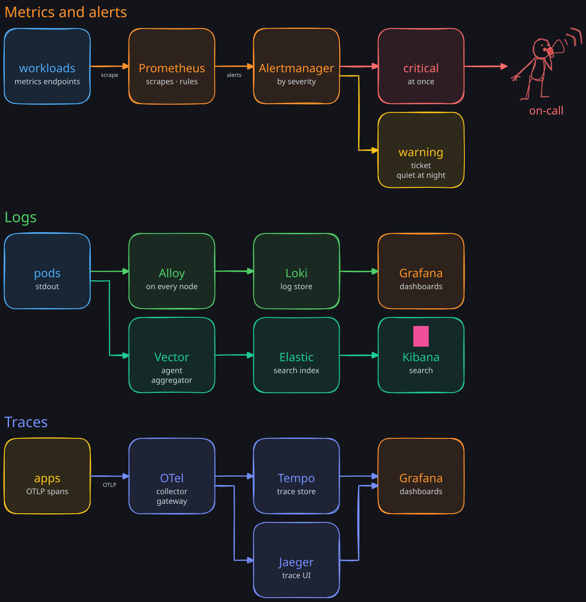

<h1 align="center">Homelab 🏡</h1>

Repository for home infrastructure and Kubernetes cluster using GitOps practices.

Held together using Proxmox VE, OpenTofu, Talos Linux, Kubernetes, Argo CD and copious amounts of YAML — with some help from Renovate.

🌍 Live: [homepage.timourhomelab.org](https://homepage.timourhomelab.org)

[](https://www.talos.dev/)
[](https://kubernetes.io/)
[](https://opentofu.org/)
[](https://argo-cd.readthedocs.io/)

<h2 align="center">Architecture 🏗️</h2>

### Hardware and network



### Platform and GitOps



### Bootstrap and deploy order



### Three ways in



### Secrets



### Observability and alerting



<sub>sources: `docs/architecture/*.excalidraw`</sub>

## 🗃️ Folder Structure

```
.
├── docs/                    architecture diagrams, runbooks, kubectl OIDC config
├── tofu/
│   ├── stacks/              one root module per state: cluster, proxmox, netbird, uptime-kuma, harbor, state
│   └── modules/             talos, openbao, rook-external
├── crossplane/              source of the crossplane-apis package: Customer, N8nInstance, PostgresDatabase
└── kubernetes/
    ├── argocd/              control plane: bootstrap (Argo CD itself, root), projects, clusters, applicationsets, crds
    ├── infrastructure/      what the cluster runs on: network, storage, security, monitoring, cluster
    ├── platform/            what teams and apps consume: identity, observability (dashboards, logs, traces), data, delivery, automation
    ├── apps/                self-hosted services: forgejo, uptime-kuma, pgadmin, homepage, n8n, excalidraw
    └── tenants/             one namespace, one AppProject, own repository: drova
```

## 🧾 Customers

A customer orders services instead of a set of manifests:

```yaml
apiVersion: customers.tim275.github.io/v1alpha1
kind: Customer
metadata:
  name: k100
spec:
  address: lab
  services: [n8n]
```

Crossplane builds namespace, database, secrets, deployment, Keycloak client and a public route (`lab-n8n.<domain>`)
behind the customer login. Orders come from the
`customer` workflow into a private orders repo: one PR per environment, staging merges right away, prod waits for review. Once the service
answers, Keycloak mails the customer an invitation to the realm `customers`. The APIs ship as a
versioned package, see [crossplane/README.md](crossplane/README.md) and the [runbook](docs/runbooks/customers.md).

## 📦 Applications

<table>
    <tr><th>Logo</th><th>Name</th><th>Description</th></tr>
    <tr>
        <td></td>
        <td><a href="https://n8n.io/">n8n</a></td>
        <td>Workflow automation in queue mode.</td>
    </tr>
    <tr>
        <td>🚗</td>
        <td><a href="https://github.com/Tim275/drova-gitops">Drova</a></td>
        <td>Ride-sharing microservices showcase, a tenant with its own repository.</td>
    </tr>
    <tr>
        <td></td>
        <td><a href="https://forgejo.org/">Forgejo</a></td>
        <td>Self-hosted Git.</td>
    </tr>
    <tr>
        <td></td>
        <td><a href="https://uptime.kuma.pet/">Uptime Kuma</a></td>
        <td>Status page.</td>
    </tr>
    <tr>
        <td></td>
        <td><a href="https://www.pgadmin.org/">pgAdmin</a></td>
        <td>PostgreSQL administration.</td>
    </tr>
    <tr>
        <td></td>
        <td><a href="https://gethomepage.dev/">Homepage</a></td>
        <td>Start page for the homelab.</td>
    </tr>
    <tr>
        <td></td>
        <td><a href="https://excalidraw.com/">Excalidraw</a></td>
        <td>Whiteboard.</td>
    </tr>
</table>

## 🛠️ Infrastructure

<table>
    <tr><th>Logo</th><th>Name</th><th>Description</th></tr>
    <tr>
        <td></td>
        <td><a href="https://www.proxmox.com/">Proxmox VE</a></td>
        <td>Hypervisor on three hosts, with Ceph for storage.</td>
    </tr>
    <tr>
        <td></td>
        <td><a href="https://www.talos.dev/">Talos Linux</a></td>
        <td>Immutable, API-driven Linux for the Kubernetes nodes.</td>
    </tr>
    <tr>
        <td></td>
        <td><a href="https://opentofu.org/">OpenTofu</a></td>
        <td>Provisions VMs, Talos, DNS and VPN as code.</td>
    </tr>
    <tr>
        <td></td>
        <td><a href="https://argo-cd.readthedocs.io/">Argo CD</a></td>
        <td>GitOps delivery with ApplicationSets and one project per layer.</td>
    </tr>
    <tr>
        <td></td>
        <td><a href="https://docs.renovatebot.com/">Renovate</a></td>
        <td>Automated dependency updates.</td>
    </tr>
    <tr>
        <td></td>
        <td><a href="https://cilium.io/">Cilium</a></td>
        <td>eBPF networking, network policies and Hubble flow visibility.</td>
    </tr>
    <tr>
        <td></td>
        <td><a href="https://gateway.envoyproxy.io/">Envoy Gateway</a></td>
        <td>Gateway API ingress with TLS, rate limiting and OIDC at the edge.</td>
    </tr>
    <tr>
        <td></td>
        <td><a href="https://developers.cloudflare.com/cloudflare-one/connections/connect-networks/">Cloudflare Tunnel</a></td>
        <td>Public services without open ports.</td>
    </tr>
    <tr>
        <td></td>
        <td><a href="https://netbird.io/">NetBird</a></td>
        <td>Zero-trust VPN for private access.</td>
    </tr>
    <tr>
        <td></td>
        <td><a href="https://istio.io/">Istio</a></td>
        <td>Service mesh in ambient mode.</td>
    </tr>
    <tr>
        <td></td>
        <td><a href="https://rook.io/">Rook-Ceph</a></td>
        <td>Block and S3 object storage from the external Ceph cluster.</td>
    </tr>
    <tr>
        <td></td>
        <td><a href="https://velero.io/">Velero</a></td>
        <td>Tiered backups and restore tests.</td>
    </tr>
    <tr>
        <td></td>
        <td><a href="https://cert-manager.io/">cert-manager</a></td>
        <td>Certificate automation.</td>
    </tr>
</table>

## 📊 Observability

<table>
    <tr><th>Logo</th><th>Name</th><th>Description</th></tr>
    <tr>
        <td></td>
        <td><a href="https://prometheus.io/">Prometheus</a></td>
        <td>Metrics and alerting with Alertmanager.</td>
    </tr>
    <tr>
        <td></td>
        <td><a href="https://grafana.com/">Grafana</a></td>
        <td>Dashboards as code via the Grafana operator.</td>
    </tr>
    <tr>
        <td></td>
        <td><a href="https://grafana.com/oss/loki/">Loki</a></td>
        <td>Log storage, fed by Alloy.</td>
    </tr>
    <tr>
        <td></td>
        <td><a href="https://grafana.com/oss/tempo/">Tempo</a></td>
        <td>Trace storage.</td>
    </tr>
    <tr>
        <td></td>
        <td><a href="https://www.jaegertracing.io/">Jaeger</a></td>
        <td>Tracing UI backed by Elasticsearch.</td>
    </tr>
    <tr>
        <td></td>
        <td><a href="https://opentelemetry.io/">OpenTelemetry</a></td>
        <td>Collectors for traces, metrics and logs.</td>
    </tr>
    <tr>
        <td></td>
        <td><a href="https://www.elastic.co/elasticsearch">Elasticsearch</a></td>
        <td>Search and log analytics with Kibana, fed by Vector.</td>
    </tr>
</table>

## 🗄️ Platform Services

<table>
    <tr><th>Logo</th><th>Name</th><th>Description</th></tr>
    <tr>
        <td></td>
        <td><a href="https://cloudnative-pg.io/">CloudNativePG</a></td>
        <td>HA PostgreSQL with backups and connection pooling.</td>
    </tr>
    <tr>
        <td></td>
        <td><a href="https://strimzi.io/">Strimzi</a></td>
        <td>Apache Kafka in KRaft mode.</td>
    </tr>
    <tr>
        <td></td>
        <td><a href="https://redis.io/">Redis</a></td>
        <td>Queues, sessions and the rate-limit backend.</td>
    </tr>
    <tr>
        <td></td>
        <td><a href="https://www.keycloak.org/">Keycloak</a></td>
        <td>Single sign-on with OpenID Connect.</td>
    </tr>
    <tr>
        <td></td>
        <td><a href="https://github.com/lldap/lldap">LLDAP</a></td>
        <td>Lightweight user directory behind Keycloak.</td>
    </tr>
    <tr>
        <td></td>
        <td><a href="https://argoproj.github.io/rollouts/">Argo Rollouts</a></td>
        <td>Progressive delivery with canary analysis.</td>
    </tr>
    <tr>
        <td></td>
        <td><a href="https://keda.sh/">KEDA</a></td>
        <td>Event-driven autoscaling.</td>
    </tr>
    <tr>
        <td></td>
        <td><a href="https://www.crossplane.io/">Crossplane</a></td>
        <td>Self-service APIs for customer instances, shipped as a versioned package.</td>
    </tr>
    <tr>
        <td></td>
        <td><a href="https://goharbor.io/">Harbor</a></td>
        <td>Private container registry, reachable over VPN only.</td>
    </tr>
</table>

## 🔐 Security

<table>
    <tr><th>Logo</th><th>Name</th><th>Description</th></tr>
    <tr>
        <td></td>
        <td><a href="https://openbao.org/">OpenBao</a></td>
        <td>Secrets management.</td>
    </tr>
    <tr>
        <td></td>
        <td><a href="https://external-secrets.io/">External Secrets</a></td>
        <td>Syncs secrets from OpenBao into Kubernetes.</td>
    </tr>
    <tr>
        <td></td>
        <td><a href="https://github.com/bitnami-labs/sealed-secrets">Sealed Secrets</a></td>
        <td>Encrypted secrets in Git for tenants.</td>
    </tr>
    <tr>
        <td></td>
        <td><a href="https://kyverno.io/">Kyverno</a></td>
        <td>Policy as code.</td>
    </tr>
    <tr>
        <td></td>
        <td><a href="https://tetragon.io/">Tetragon</a></td>
        <td>eBPF-based runtime security.</td>
    </tr>
    <tr>
        <td></td>
        <td><a href="https://trivy.dev/">Trivy</a></td>
        <td>Vulnerability scanning for running images.</td>
    </tr>
    <tr>
        <td></td>
        <td><a href="https://github.com/aquasecurity/kube-bench">kube-bench</a></td>
        <td>CIS benchmark checks.</td>
    </tr>
</table>
